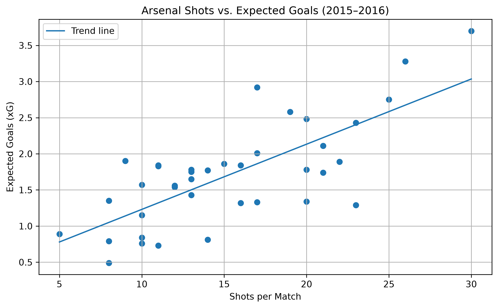
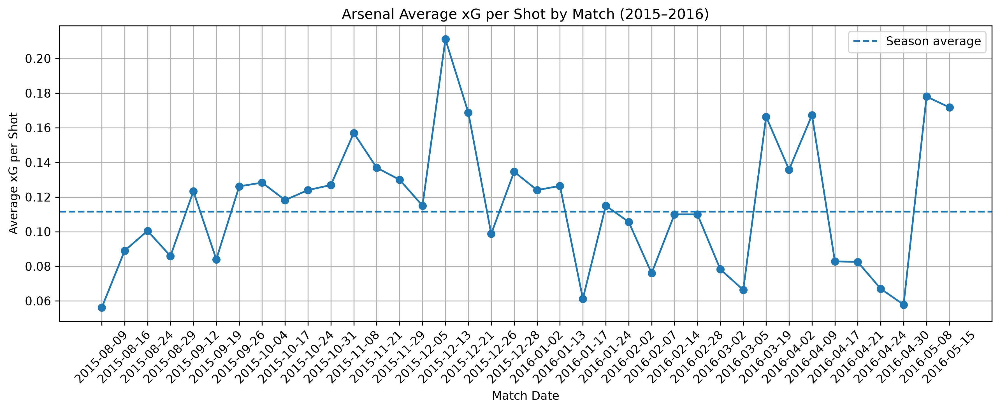
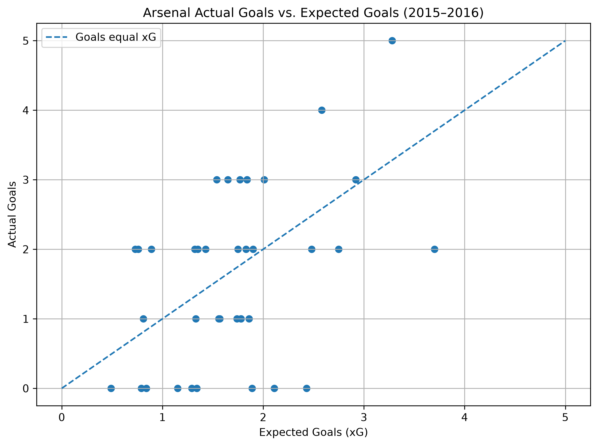

# Arsenal Attacking Analysis (2015–2016 Season)

## Project Overview

This project analyzes Arsenal Football Club's attacking performance for the 2015–2016 English Premier League season using StatsBomb open event data.

Using Python, the project examines all 38 matches of Arsenal's 2015–2016 season to evaluate shot volume, expected goals (xG), actual goals scored, and shot quality. The analysis explores the relationship between attacking opportunities and scoring outcomes to identify patterns in Arsenal's offensive performance, specifically examining if and how shot volume relates to goals.

Three charts illustrate key performance metrics and provide insights into the team's attacking efficiency throughout the season.

## Data Source

Match and event data were obtained from the [StatsBomb Open Data repository](https://github.com/statsbomb/open-data), which provides publicly available football match data for research and analysis.

- Competition: English Premier League
- Season: 2015–2016
- Team analyzed: Arsenal
- Matches analyzed: 38
- Data type: Match-level and event-level data

## Technologies Used

- **Python** – Core programming language
- **Pandas** – Data manipulation and analysis
- **NumPy** – Numerical calculations and statistical analysis
- **Matplotlib** – Data visualization
- **StatsBomb Open Data** – Football match and event data

## Key Findings

Analysis of Arsenal's 38 Premier League matches revealed several insights into the team's attacking performance.

### 1. Shot Volume and Expected Goals

- Arsenal averaged **15.34 shots per match**.
- Arsenal averaged **1.71 expected goals (xG) per match**.
- Shot volume and expected goals showed a fairly positive correlation of **0.738**,
indicating at first glance that matches with a higher shot volume generally produced
higher expected-goal totals.

### 2. Shot Quality

- Arsenal averaged approximately **0.112 xG per shot** across the season. In other words, the average shot had an estimated 11.2% probability of resulting in a goal, based on the StatsBomb expected-goals model.
- Against West Ham United on August 9, 2015, Arsenal recorded 23 shots but generated only 1.29 xG.
- Against Aston Villa on December 13, 2015, Arsenal recorded just 9 shots but generated 1.90 xG.

These matches illustrate why shot quality can be just as important as shot volume when evaluating attacking performance.

### 3. Actual Goals vs. Expected Goals

- Total actual goals: **62**
- Total expected goals: **65.08**
- Difference: **-3.08 goals**

Arsenal scored roughly three fewer goals than their expected-goal total across the season. This provides a useful comparison between the quality of chances created and actual scoring outcomes.

### 4. Match-Level Scoring Variation

Some matches showed substantial differences between actual goals and expected goals:

- Leicester City (September 26, 2015): 5 goals from 3.28 xG.
- Southampton (February 2, 2016): 0 goals from 2.43 xG.

These differences illustrate how actual scoring outcomes can vary considerably from expected-goal estimates in individual matches.

## Visualizations

### 1. Arsenal Shots vs. Expected Goals

This scatter plot examines the relationship between shot volume and expected goals across Arsenal's 38 league matches. The positive correlation of 0.738 suggests that matches with more shots generally produced higher expected-goal totals.



### 2. Average Expected Goals per Shot

This chart tracks the average xG per shot in each match throughout the season. The dashed line represents Arsenal's season average of 0.112 xG per shot.



### 3. Actual Goals vs. Expected Goals

This scatter plot compares Arsenal's actual goals with expected goals in each match. Points above the diagonal line represent matches where Arsenal scored more than expected, while points below represent matches where Arsenal scored fewer goals than expected.



## How to Run the Project

### 1. Clone the Repository

Download the project to your computer:

```bash
git clone https://github.com/your-username/arsenal-analytics.git
cd arsenal-analytics

python3 -m pip install -r requirements.txt

python3 arsenal_analysis.py